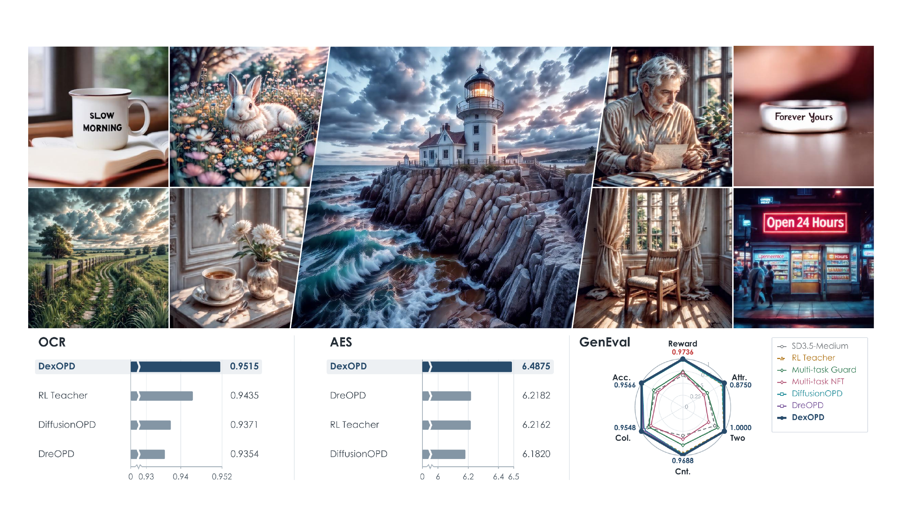

# DexOPD for Stable Diffusion 3.5 Medium

DexOPD adapts Stable Diffusion 3.5 Medium for three capabilities in one
text-to-image model: compositional alignment, text rendering, and visual quality.
The same student generates all three types of outputs with the standard
SD3.5 Medium pipeline.

Yunchao Ke, Yanzhe Hu, Yi Yang, Jiachun Jin, Zhihong Liu, and Zhijie Deng

[Paper PDF](https://sjtu-deng-lab.github.io/DexOPD/assets/dexopd-paper.pdf) · [Project and interactive comparisons](https://sjtu-deng-lab.github.io/DexOPD/) · [Code](https://github.com/SJTU-DENG-Lab/DexOPD)



## Released checkpoint

| Field | Value |
| --- | --- |
| Base model | [Stable Diffusion 3.5 Medium](https://huggingface.co/stabilityai/stable-diffusion-3.5-medium) |
| Weights | [PEFT LoRA on the SD3 transformer](https://huggingface.co/kyc001/DexOPD/blob/main/adapter_model.safetensors) |
| Configuration | [Rank 32, alpha 64](https://huggingface.co/kyc001/DexOPD/blob/main/adapter_config.json) |
| Checkpoint | Evaluation EMA after 1,000 optimizer updates |
| Training recipe | 72 cases per update, teacher extrapolation λ = 1.2, auxiliary weight β = 1.8 |

## Generate an image

Use a CUDA-enabled PyTorch installation and install the inference dependencies
below. Request access to the SD3.5 Medium files and authenticate with a
Hugging Face account that has access. [Base model access and terms](https://huggingface.co/stabilityai/stable-diffusion-3.5-medium)

```bash
python -m pip install -r https://raw.githubusercontent.com/SJTU-DENG-Lab/DexOPD/main/requirements.txt
huggingface-cli login
```

```python
import torch
from diffusers import StableDiffusion3Pipeline
from peft import PeftModel

pipe = StableDiffusion3Pipeline.from_pretrained(
    "stabilityai/stable-diffusion-3.5-medium", torch_dtype=torch.float16
)
pipe.transformer = PeftModel.from_pretrained(pipe.transformer, "kyc001/DexOPD")
pipe.to("cuda")
pipe.vae.to(dtype=torch.float32)

with torch.inference_mode(), torch.autocast("cuda", dtype=torch.float16):
    image = pipe(
        'A shop window with a sign that reads "OPEN LATE"',
        height=512,
        width=512,
        num_inference_steps=40,
        guidance_scale=4.5,
        generator=torch.Generator(device="cuda").manual_seed(42),
    ).images[0]
image.save("dexopd.png")
```

## What the adapter learns

During on-policy distillation, the student samples trajectories and receives
targets from specialists for composition, text, and visual preference. DexOPD
extrapolates each teacher away from the frozen base model to strengthen its
targets. In parallel, it uses the difference between the current student and
its historical EMA to generate candidates from the same initial noise. Task
rewards turn differences between candidates into an auxiliary training
direction. Generation uses a single student trajectory.

## Evaluation

The paper evaluates the released student at 512 × 512 with 40 inference steps
and guidance scale 4.5. Each next-best result below is from the same table.

| Primary metric | DexOPD | Next-best result in Table 1 | Gain |
| --- | ---: | --- | ---: |
| GenEval reward | **0.9736** | 0.9622 (DreOPD) | +0.0114 |
| OCR | **0.9515** | 0.9435 (OCR Teacher) | +0.0080 |
| DrawBench Aesthetic | **6.4875** | 6.2813 (STEP-OPD, paper-based reproduction) | +0.2062 |

The project gallery shows selected 1024 × 1024 outputs. For the other DrawBench
metrics, GenEval subcategories, and evaluation protocol, see Table 1 and the
appendix. [Paper PDF](https://sjtu-deng-lab.github.io/DexOPD/assets/dexopd-paper.pdf)

## Access and terms

The adapter is publicly downloadable. The base model is gated and subject to the
Stability AI Community License. The training and evaluation code is released
under Apache 2.0. [Base model license](https://huggingface.co/stabilityai/stable-diffusion-3.5-medium/blob/main/LICENSE.md) · [Code license](https://github.com/SJTU-DENG-Lab/DexOPD/blob/main/LICENSE)

## Citation

```bibtex
@misc{ke2026dexopd,
  title  = {DexOPD: Dual-Extrapolation On-Policy Distillation for Diffusion Models},
  author = {Yunchao Ke and Yanzhe Hu and Yi Yang and Jiachun Jin and Zhihong Liu and Zhijie Deng},
  year   = {2026}
}
```
