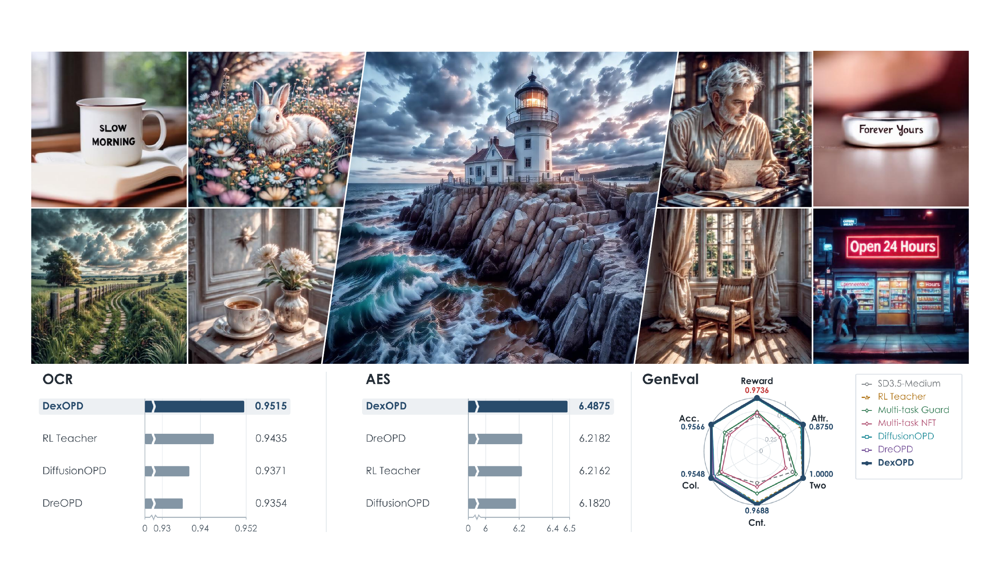
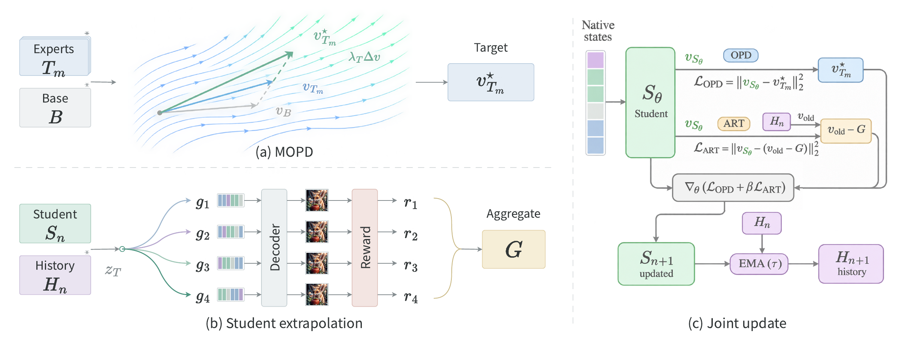
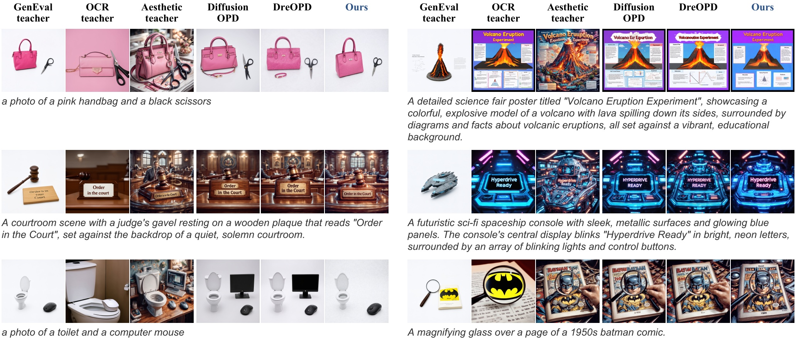

# DexOPD: Dual-Extrapolation On-Policy Distillation for Diffusion Models

**Yunchao Ke\*, Yanzhe Hu\*, Yi Yang, Jiachun Jin, Zhihong Liu, Zhijie Deng†**

\* Equal contribution. † Corresponding author.

[](docs/assets/dexopd-paper.pdf)
[](https://sjtu-deng-lab.github.io/DexOPD/)
[](https://github.com/SJTU-DENG-Lab/DexOPD)
[](https://huggingface.co/kyc001/DexOPD)
[](LICENSE)

DexOPD distills three frozen Stable Diffusion 3.5 Medium teachers into a single
student LoRA. It extrapolates teacher transition targets away from the base
model and uses reward-scored student rollouts to guide student self-extrapolation.



## Project page and examples

Visit the [project page](https://sjtu-deng-lab.github.io/DexOPD/) for
interactive method diagrams, complete Table 1 results, and ablation charts, or
open the [qualitative comparisons](https://sjtu-deng-lab.github.io/DexOPD/examples.html)
to inspect pre-generated paper examples. For a local preview, open
[`docs/index.html`](docs/index.html) in a browser. The site works without a
build step or model inference.

## Method

Teacher extrapolation strengthens the distillation target at states visited by
the student. Student self-extrapolation uses a history EMA to generate candidate
endpoints and turns differences in their rewards into an auxiliary training
target.



## Setup

The release training recipes use Linux, Python 3.10, PyTorch 2.6, and eight
NVIDIA H20 GPUs. Run the commands from the repository root.

```bash
python -m pip install torch==2.6.0 torchvision==0.21.0 --index-url https://download.pytorch.org/whl/cu126
python -m pip install -r requirements.txt
```

### Base model and teachers

Accept the terms for the gated [SD3.5 Medium model](https://huggingface.co/stabilityai/stable-diffusion-3.5-medium) on Hugging Face, then run `huggingface-cli login`. For a local Diffusers snapshot, pass `--base-model models/sd35` in training and set `SD35_MODEL=models/sd35` for evaluation.

Training downloads the three frozen adapters from [quanhaol/DiffusionOPD](https://huggingface.co/quanhaol/DiffusionOPD). To download them to your own model directory, run

```bash
huggingface-cli download quanhaol/DiffusionOPD \
  --include "AesTeacher/lora/*" "OCRTeacher/lora/*" "GenEvalTeacher/lora/*" \
  --local-dir models/teachers
```

Pass `--teacher-root models/teachers` to either training command.

### Model and scorer assets

The scorer paths below are relative to `ASSET_ROOT`, which defaults to
`assets/`. Prepare the reward weights and native detector environment using
the [DiffusionOPD reward instructions](https://github.com/ali-vilab/DiffusionOPD#reward-preparation).

| Asset | Location and identity |
| --- | --- |
| GenEval detector | `reward_ckpts/mask2former_swin-s-p4-w7-224_lsj_8x2_50e_coco_20220504_001756-743b7d99.pth` |
| GenEval config and CLIP | `geneval/mask2former_swin-s-p4-w7-224_lsj_8x2_50e_coco.py`, its referenced configs, and the OpenCLIP ViT-L/14 cache |
| OCR | PaddleOCR 2.9.1 English assets under `ocr/` with `det/`, `rec/`, `cls/`, and `en_dict.txt` |
| Aesthetic | `reward_ckpts/sac+logos+ava1-l14-linearMSE.pth` and `openai/clip-vit-large-patch14` |
| HPSv2.1 | `reward_ckpts/HPS_v2.1_compressed.pt` and `reward_ckpts/open_clip_pytorch_model.bin` |
| PickScore, CLIPScore, ImageReward | `yuvalkirstain/PickScore_v1`, `openai/clip-vit-large-patch14`, and `ImageReward-v1.0` in their model caches |

Install the scorer dependencies in the environments that run them.

| Scorer | Additional packages |
| --- | --- |
| GenEval | MMDetection 2.x, a compatible MMCV 1.x build with CUDA operators (e.g., MMCV 1.7.2 in a dedicated Python 3.10 env), `open-clip-torch`, `clip-benchmark` |
| OCR | PaddlePaddle 2.6.2 and `paddleocr==2.9.1` |
| DrawBench | `hpsv2x==1.2.0` (provides `hpsv2`), `image-reward`, and [OpenAI CLIP](https://github.com/openai/CLIP) |

If MMDetection is cloned outside `assets/geneval/`, point `GENEVAL_CONFIG` to its Mask2Former config (e.g., `export GENEVAL_CONFIG=/path/to/mmdetection/configs/mask2former/mask2former_swin-s-p4-w7-224_lsj_8x2_50e_coco.py`).

## Training

```bash
torchrun --standalone --nproc-per-node=8 -m dexopd.train --output runs/main
torchrun --standalone --nproc-per-node=8 -m dexopd.train --small-batch --output runs/small
```

The main recipe uses **72 cases per update** across eight GPUs. The small-batch
recipe uses **24 cases per update**. Both run 1,000 updates, with two updates
per collection round and BF16 autocast. See [settings.json](dexopd/settings.json)
for the extrapolation, history, and optimizer settings.

For separate scorer environments, pass their Python executables with
`--ocr-python` and `--geneval-python`. The `lora/` directory under
`checkpoints/checkpoint-N` contains the evaluation EMA. Resume a complete
training checkpoint with `--resume` and the same model, recipe, and rank count.

## Quick inference

The [published DexOPD adapter](https://huggingface.co/kyc001/DexOPD) is the EMA
LoRA used for the paper's main results at update 1,000. The base SD3.5 Medium
model requires Hugging Face access as described in [Setup](#setup). See the
[model card](MODEL_CARD.md) for checkpoint details and benchmark context.

```python
import torch
from diffusers import StableDiffusion3Pipeline
from peft import PeftModel

pipe = StableDiffusion3Pipeline.from_pretrained(
    "stabilityai/stable-diffusion-3.5-medium", torch_dtype=torch.float16
)
pipe.transformer = PeftModel.from_pretrained(
    pipe.transformer, "kyc001/DexOPD"
)
pipe.to("cuda")
pipe.vae.to(dtype=torch.float32)

with torch.inference_mode(), torch.autocast("cuda", dtype=torch.float16):
    image = pipe(
        'A shop window with a sign that reads "OPEN LATE"',
        height=512, width=512, num_inference_steps=40, guidance_scale=4.5,
    ).images[0]
image.save("sample.png")
```

For a local training run, replace `kyc001/DexOPD` with the path to its `lora/`
directory, for example `runs/main/checkpoints/checkpoint-1000/lora`.

## Evaluation

```bash
CHECKPOINT_DIR=runs/main/checkpoints/checkpoint-1000 \
  EVALUATION_DIR=runs/main/evaluation bash scripts/evaluate.sh

CHECKPOINT_DIR= EVALUATION_DIR=runs/base/evaluation \
  NUM_PROCESSES=1 SAVE_IMAGES=1 bash scripts/evaluate.sh
```

The evaluator runs the full GenEval, OCR, and DrawBench test splits at 512×512
and 40 inference steps with FP16 autocast and an FP32 VAE. GenEval and OCR
use their corresponding splits. DrawBench reports Aesthetic, PickScore,
ImageReward, CLIPScore, and HPSv2.1. Each metric has weight 1 in its split.
PickScore and CLIPScore use logits divided by 26 and 100, respectively.
DrawBench's `avg` is the sum of its five scores.

| Variable | Behavior |
| --- | --- |
| `CHECKPOINT_DIR` | Path to a checkpoint containing `lora/`. Leave empty for base SD3.5-Medium. |
| `SD35_MODEL` | Optional local SD3.5-Medium snapshot. |
| `EVAL_CFG` | Defaults to `4.5`. Use `EVAL_CFG=1` for DiffusionNFT and DiffusionART. |
| `NUM_PROCESSES` | CUDA process count, default `8`. One GPU uses `NUM_PROCESSES=1`. |
| `SAVE_IMAGES` | Set to `1` to save images from all three splits. Defaults to `0`. |
| `PYTHON` | Evaluation interpreter, default `python`. Set `GENEVAL_EVAL_PYTHON` or `OCR_EVAL_PYTHON` for split-specific environments. |

Each split writes per-image scores to `evaluation_results.jsonl` and
aggregate scores to `average_scores.json`.

## Visual comparisons



## Baselines

See the [baseline settings summary](baselines/README.md).

## Unit tests

```bash
python -m unittest discover -s tests -v
```

The equivalence tests use small CPU tensors and the training dependencies.
The OCR and repository sanity tests use the Python standard library.

## Citation

```bibtex
@misc{ke2026dexopd,
  title  = {DexOPD: Dual-Extrapolation On-Policy Distillation for Diffusion Models},
  author = {Yunchao Ke and Yanzhe Hu and Yi Yang and Jiachun Jin and Zhihong Liu and Zhijie Deng},
  year   = {2026}
}
```

## Acknowledgements

Thanks to the DiffusionOPD, Flow-GRPO, Diffusers, and Stable Diffusion teams
for releasing their code and models. [Third-party notices](THIRD_PARTY_NOTICES.md)
